### sevval@github ~ $ ./contributions.sh

  

### sevval@github ~ $ whoami

<table>
  <tr>
    <td valign="top"></td>
    <td valign="top"></td>
  </tr>
</table>

  

### sevval@github ~ $ ./stats.sh

 

[Instagram · @themightydeveloper](https://instagram.com/themightydeveloper) &nbsp;·&nbsp; [LinkedIn](https://www.linkedin.com/in/sevvalturkyilmaz/)

